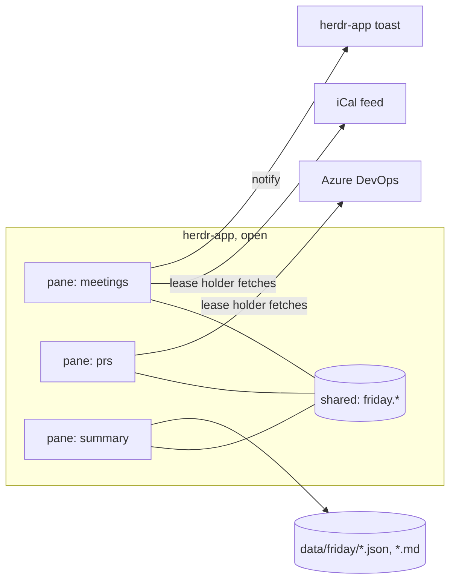

# Friday for herdr-app

> Notes this document cites but does not include (interviews, decision sessions, data, the first-version spec and agent run logs) are the maintainer's local notes and are not part of this repository. The ids (`D`, `R`, `N`, `G`) and the rows here are what the code and the docs rely on.

## 📝 TLDR

Proposed: Friday is rebuilt from scratch as one JavaScript (gpui-kit) mod for herdr-app, herdr's desktop app (`herdrdev/herdr-app`, 0.1.x). It lives in a Friday tab whose panes the owner moves, resizes and splits with herdr-app's own tools, and it keeps the first version's product rules but none of its Rust code. Today Friday is a herdr terminal plugin (`NexorPL/herdr-friday`, v1) with a fixed 2×2 Today screen and little guidance on setup. On 2026-11-02 the owner chose to build Friday anew here and leave the terminal plugin where it is.

## 📝 Problem Statement

- The terminal plugin draws a ratatui dashboard: a Today screen with four fixed quarters and five detail views behind keys 2–6. The first-version spec chose a fixed layout on purpose: "ten fixed widgets do not need" a configurable grid (`2026-10-30-friday-first-version.md`, Prior art).
- The owner installed it on 2026-11-02. The panels cannot be moved, and nothing in Friday says where `config.toml` is or what to set up first; the only pointer is `? help` in the footer. `[INTERVIEW]` 2026-11-02.
- herdr-app draws its window from layout files and JavaScript mods. A mod pane splits, resizes, zooms, drags and closes like a terminal pane, and is saved with its tab, with no layout code in the mod. The owner wants Friday there, designed for it from the start. `[INTERVIEW]` 2026-11-02.

## 📝 Proposed Solution

One mod, `friday`, that draws whichever widget its `props.widget` names. A Friday tab holds several panes of it, each showing one widget. The first pane of a new Friday tab arranges the default panes, and from then on the owner rearranges them with herdr-app. Everything runs inside the mod while herdr-app is open: polling with `fetch`, state in JSON files, alerts as herdr-app toasts. Nothing runs when herdr-app is closed.

Alternatives considered:

- **A `friday` layout file** (the first reading of Q7). It lost because a layout is a whole window: switching back to the main layout stops its mods ("Another layout starts its mods fresh", herdr-app `AGENTS.md`), and with them the alerts. A mod pane in a tab instead "stays alive while its block is in the layout, shown or not (… a pane in another tab …)". So alerts keep working while the owner works in other tabs.
- **One pane that draws every widget, with its own dragging and resizing** (Q7 b). It lost because herdr-app already does this for panes.
- **A Rust backend with JavaScript only for drawing** (Q1 a). It lost because the owner wants Friday designed for herdr-app from scratch.
- **The OS keyring through system tools** (Q8). It lost because the owner wants another way.

### Prior art (checked 2026-11-02)

- **`jankeesvw/herdr-issues`**, a GitHub issues panel in pure JavaScript. It keeps its data in `${appHome()}/data/issues`, keeps small caches in `localStorage` and preferences in `shared()`, polls with `cx.timer.every` and skips the poll while hidden, and leaves sign-in to the `gh` CLI. Friday takes the data-folder convention and the timer pattern. It does not skip polling while hidden, because alerts must fire from a pane the owner is not looking at.
- **`mrolafsson/herdr-linear`, `mrolafsson/herdr-github`**: a Go helper binary next to the mod (OAuth, or `gh`'s sign-in). Friday has no helper, by Q1.
- **wtfutil**: see the first-version spec. Its per-source refresh interval stays.

## 📝 Architecture

```
mods/friday/
  main.js          View: reads props().widget, renders that widget, starts the hub
  mod.json         { "place": "none", "focusable": true }
  hub.js           polling, leases, source state in shared(), the alert loop
  store.js         Friday's data folder: settings, secrets, JSON state, compare-and-swap writes
  open.js          opening https links and files with the OS (exec)
  widgets/         summary, meetings, prs, priorities, todos, ledger, jira, favorites, notes, tokens
  dialogs/         settings, log-day, log-time, repo-picker, quick-note, prices
  core/            pure logic, never imports "herdr": durations, backoff, ledger, mdfile,
                   worklogs (R09), jira, ado, prs, meetings (+ vendor/ical.js), tokens/*, pricing
test/              node --test over core/ with anonymized fixtures (D32)
```

- **Copies and the hub.** Every pane is its own copy of the mod, with its own `init` and timers. A copy's hub runs `cx.timer.every(5000)` and handles each source its widgets need: meetings, Jira, Azure DevOps, ledger and tokens.
  - When a source is due, the copy takes a lease (`setShared("friday.lease.<source>", {copy, until})`), fetches, and writes the result to `shared("friday.<source>")` as `{data, ok_at, error, backoff_until}`.
  - Every other copy re-renders from the shared value.
  - A lost race costs one duplicate fetch with the same result.
  - The meetings source's lease holder also runs the alert loop.
  - Phase 1 checks whether copies share one module scope. If they do, the hub becomes a module singleton and the leases go.
- **Secrets** are read from `secrets.json` by the copy that fetches, kept in that copy's memory, and never put in `shared()`, `localStorage`, logs, errors or toasts.
- **External calls**:
  - `fetch` for Jira, Azure DevOps, the iCal feed and LiteLLM;
  - `exec` for the OS link opener and the token-file listing;
  - `readTextFile` for the ledger and transcripts;
  - `writeTextFile` for everything Friday writes.
- **Local only.** Friday reads the ledger and transcripts on this computer. It never passes `on`, even when the Friday tab sits in a space on another machine.



Takeaway: all panes are one mod. Whichever pane holds a source's lease fetches it for all of them, and all state lives in `shared()` and Friday's data folder.

## 📝 Data Model

Friday's data folder is `${appHome()}/data/friday/`, by default `~/.config/herdr-app/data/friday/` (Q9). Every JSON file carries `"version": 1`. A Friday that finds a newer version leaves the file alone and shows which version it needs.

| File | Holds | Written by |
|---|---|---|
| `settings.json` | the owner's settings (below) | Settings dialog; hand edits allowed |
| `secrets.json` | `jira_token`, `ado_pat`, `ical_url` | Settings dialog only |
| `todos.md`, `notes.md`, `priorities.md`, `favorites.md` | the owner's lists (D26), plain Markdown under R10 | widgets and the owner |
| `worklogs.json` | worklogs Friday wrote: `jira_id, issue_key, day, started, seconds, comment, origin (ledger or favorite), ledger_pr, created_at`; input to R09 | log-day and log-time dialogs |
| `alerts.json` | `{"version": 1, "sent": {"<uid>|<occurrence_start>|<offset_min>": sent_at}}`, pruned after 7 days (R11) | alert loop |
| `prs.json` | per repo: `baseline_set`, and per PR `first_seen_at, last_seen_at, active, unseen, notified` (rules of G15/G34 as in the first-version spec) | PR source, mark-seen actions |
| `prices.json` | per model: `input, output, cache_creation, cache_read` (USD per million), `origin` (`litellm` or `manual`), `updated_at` | Tokens widget, prices dialog |
| `tokens.json` | per file: `size, mtime`, and per day and model `input, cache_creation, cache_read, output`, pruned beyond `history_days`. Provisional until Phase 6's measurement gate passes | token source |

Caches that the sources refill live in `shared()`. They are persisted by herdr-app in `shared.json`:

- `friday.meetings`, the window of today and tomorrow;
- `friday.jira`, assigned issues plus the keys in favorites and priorities;
- `friday.prs`;
- `friday.ledger`;
- `friday.status`, each source's last success, error and backoff.

`settings.json` uses the first version's config keys and meanings, in JSON. `files.dir` is gone, because the lists live in the data folder (Q9). The new keys are `azure_devops.project` and `azure_devops.repo`, which the picker writes. The keys:

- `ledger.path`;
- `jira.site`, `jira.email`, `jira.token_kind` (`scoped` or `classic`), `jira.interval`;
- `azure_devops.organization`, `azure_devops.project`, `azure_devops.repo`, `azure_devops.interval`;
- `calendar.email`, `calendar.interval`, `calendar.alerts`;
- `tokens.interval`, `tokens.history_days`, `tokens.claude_dir`, `tokens.codex_dir`, `tokens.pi_dir`;
- `notifications.sound`.

Defaults and validation follow `BACKWARD_COMPATIBILITY.md` of `herdr-friday`. Durations are written `30s`, `5m`, `1h 30m`; intervals are above zero, and intervals and alerts are at most 24 h. An invalid value falls back to its default, and Settings names the key.

Sensitive data:

- `secrets.json` is plain text, protected only by the user account's file permissions. The owner accepted this on 2026-11-02 in place of R01 (Q8).
- Work data (meeting titles, PR titles, issue summaries) stays on the machine, in the data folder and `shared.json` (N02). It never goes into fixtures (D32).

## 📝 API Contracts

**Outbound HTTP.** These are the calls, auth, base URLs and error handling of the first-version spec (Outbound calls), made with `fetch`:

- 15-second timeout;
- backoff on 429 and 5xx, starting at twice the interval and doubling. `Retry-After` cannot be honoured, because herdr-app's `fetch` exposes no response headers;
- "token rejected" on 401 and 403, with no retry until the secret is replaced or the owner refreshes;
- error messages built from the source name and status code only, never from a URL, header or body. The iCal URL is a secret.

Basic auth is encoded with `btoa`. `Buffer` base64 returns an empty string in herdr-app.

**Programs run with `exec`.** No shell is involved, and arguments go as an array.

| Need | Windows | macOS | Linux |
|---|---|---|---|
| open an `https` link or a file | `rundll32 url.dll,FileProtocolHandler <target>` | `open <target>` | `xdg-open <target>` |
| list token files with size and mtime | `powershell -NoProfile -Command` with `Get-ChildItem -Recurse -File -Filter *.jsonl` on the folder, one line per file | `find <dir> -name '*.jsonl' -exec stat -f '%m %z %N' {} +` | `find <dir> -name '*.jsonl' -printf '%T@ %s %p\n'` |

**herdr-app surface used:**

- `tab.new` and `pane.split` with `{mod: "friday", props: {widget}}`;
- `notify`, `playSound`, `openOverlay` and `closeOverlay`;
- `shared` and `setShared`;
- `readTextFile`, `writeTextFile` and `watchFolder`;
- `fs/promises`;
- `exec`;
- `panes()` and `focused()`.

Checked against herdr-app 0.1.11's `herdr.d.ts` and `herdr-app commands`.

**Opening Friday.** This command makes a Friday tab in the selected space. Its first pane arranges the rest when it is the only pane in its tab. The tab is kept by herdr-core, so the command is needed once, and again only after the owner closes the tab.

```sh
herdr-app do tab.new --name Friday --mod friday --props '{"widget":"summary"}'
```

**Protected surfaces** (a new `BACKWARD_COMPATIBILITY.md`). Each one enters that file in the phase that ships it, never before:

- **The mod name `friday` and the `widget` values.** Tabs saved in herdr-core refer to them, so a rename breaks the owner's saved panes.
- **`settings.json` keys.**
- **The data-folder files and their `version`.**
- **R02's token formula**, together with `tokens.json`, `prices.json` and the `tokens.*` keys, only once Phase 6 ships.

## 📝 UI/UX

Default arrangement, made by the first pane of a new Friday tab:

```
┌ summary: 14:05:32 · Thu 2026-11-05 · review 35 min (7 runs) · tokens 1.2M $4.10 · ⚙ ┐
├ meetings ──────────────────────────┬ priorities ───────────────────────────────────┤
│ all day  Sprint review week        │ 1  KEY-12  Fix login timeout   In Progress    │
│ 14:30    Standup             Teams │ 2  Prepare the demo                           │
├ pull requests ─────────────────────┼ todos ────────────────────────────────────────┤
│ ● !812  Add retry to upload        │ [ ] Call the bank                             │
└────────────────────────────────────┴───────────────────────────────────────────────┘
```

- **Panes.** The owner drags panes by herdr-app's grip, resizes splits and closes panes.
  - Each Friday pane draws a one-line header: the widget name, its state ("updated 14:03", "offline since 13:50"), ↻ refresh, ⚙ Settings, and **+**.
  - **+** opens a menu of widgets and splits a new pane with the chosen one beside this pane, to the right or below. This is how the detail widgets (ledger, Jira, favorites, notes, tokens) are added; the default arrangement leaves them out.
- **Mouse first, keys when focused.** Rows respond to clicks. A focused pane (`focusable: true`, reached with `pane.go`) takes the first version's keys where they still fit:
  - ↑ and ↓ move the row cursor;
  - Enter opens or joins the row;
  - Space toggles a todo;
  - `a` adds a line and `e` edits;
  - `h` shows past meetings;
  - `m` marks pull requests seen;
  - `L` logs a ledger day;
  - `n` writes a quick note.
- **Setup.** This answers the owner's "the user does not know what to do".
  - Until Settings has been saved once, the summary pane shows a checklist instead of totals: Calendar, Jira, Azure DevOps, Review ledger, Tokens. Each row has its state and a button that opens Settings at that section.
  - A widget whose source is not set up says what is missing, with the same button.
- **Settings dialog** (`openOverlay`, kind `dialog`):
  - sections per source;
  - Friday's version, and the data folder path with an "Open folder" button;
  - secrets in masked inputs, each with **Test**, which calls `myself`, the repositories list, or fetches the feed, and shows OK or "token rejected";
  - the Azure DevOps project, then repo, picker;
  - the command that reopens the Friday tab.
- **Flows kept from the first version**, drawn as dialogs: log a ledger day (D27, R09), time on a favorite (R07), and the price review after fetching LiteLLM.
- **Toasts** use the first version's wording: `New PR !<id>`, and `In <offset>: <title>` with `Teams` or `Meet`. The `notifications.sound` setting plays `done` or `blocked`, or nothing.
- **Widget states** are the first version's five: loading, OK, stale, error and not set up. Colors come from `theme()`.

## 📝 Edge Cases & Failure Scenarios

Source-level cases are those of the first-version spec, carried over unchanged:

- recurrence and DST, unknown TZID, all-day events, declined meetings, join links;
- R09 matching, including a timeout after Jira saved the worklog;
- `.md` edits keeping CRLF, BOM and a missing final newline, and a line changed underneath;
- shrunk transcript files and models without a price.

New here:

- **herdr-app closed, or the Friday tab closed.** Nothing polls or alerts. On the next start every source is fetched at once. Alerts more than 60 seconds late are dropped (R11), so a restart does not replay the morning's alerts.
- **Two panes race for a lease.** Both fetch, and both write the same result. `alerts.json` is written with compare-and-swap, and an alert whose key is already there is not sent. So at most one toast per occurrence and offset, even in a race.
- **Hot reload or a Friday update.** The old build's timers stop. The new build resumes from `shared()` and the data folder.
- **The first pane starts again** after an app restart or a reload. It arranges only when it is the only pane in its tab, so an arranged tab is never rearranged.
- **`writeTextFile` conflicts.** A stale snapshot is rejected. Friday re-reads, re-applies the one change to the matching line (R10), and writes again once. If the line is gone it shows "file changed, try again".
- **Missing or broken `secrets.json` or `settings.json`.** A broken file keeps its content, and is copied aside as `<name>.corrupt-<time>` before Friday starts from defaults. Widgets show "not set up".
- **Size limits.**
  - `readTextFile` stops at 1 MiB. A larger ledger or list shows "file too large".
  - Transcripts can only be read with `readTextFile`, so they stop at 1 MiB too. `fs.readFile` reads outside the granted roots are refused.
  - `exec` stops at 30 s and 8 MiB of output. A token folder whose listing exceeds that shows "too many files in `<dir>`".
- **QuickJS.** Friday does not rely on `Intl`, and formats dates and numbers itself. Time-zone math for the feed comes from the feed's own `VTIMEZONE` (ical.js), and the machine's offset from `Date`.
- **A herdr-app update changes the mod API.** `herdr-app check` and `herdr-app status` report the error, and the README names the herdr-app version Friday was checked against.
- **Untrusted text.** Only `https` links from calendar text are opened. Nothing from a feed or an issue is passed to `exec` except as a single argument to the link opener.

## 📝 Risks & Impact Review

- **Secrets in plain text** (Q8, supersedes R01). Any program under the owner's account, and any backup or sync of `~/.config/herdr-app`, can read the iCal address (the whole calendar), the Jira token (which can write worklogs) and the Azure DevOps PAT (Code Read). The owner accepted this on 2026-11-02. Friday keeps the secrets in one file, apart from the settings, and out of `shared()`, logs and errors.
- **herdr-app is at 0.1.x.** Its mod API can change. All Friday code that touches herdr-app is in `main.js`, `hub.js`, `store.js`, `open.js` and the widgets; `core/` does not depend on it.
- **Two runtimes.** Tests run `core/` in Node, while the mod runs in QuickJS. Phase 1 records where they differ (module scope, `fetch` timeouts, `Date`), and `herdr-app check` runs before every merge on the owner's machine.
- **Transcripts over 1 MiB (Phase 6).** `fs.readFile` outside the granted roots is refused, so `readTextFile` (1 MiB) is the only way to read a transcript. A larger file cannot be read whole, and Phase 6's measurement gate must count how many there are.
- **D40's premise turned out false (Q9).** "A mod writes files only under `~/.config/herdr-app`" does not hold: `writeTextFile` works outside it. The owner may revisit where the lists live. D40 is unchanged.
- **Token scan time** on the work machine is unknown (Q10). Phase 6 starts with a measurement. If a full scan takes too long in the UI process, tokens move to Later and the owner is asked. **Result (2026-11-04): the gate failed on size, not time.** On the owner's machine 223 of 416 Claude Code transcripts (54%) are over 1 MiB, 6 are over 10 MiB, and `readTextFile` reads at most 1 MiB with no ranged read. The owner moved tokens to Later.
- **`ical.js`** (Mozilla, MPL-2.0) is vendored unmodified, with its license file. The MPL's file-level copyleft does not reach Friday's MIT code. Phase 3 begins by checking that it loads in QuickJS. The fallback is porting the first version's recurrence rules.
- **No UI tests.** Widgets stay thin over `core/`, and every phase ends with `herdr-app check` and screenshots (`herdr-app shot`) attached to its PR.
  - The screenshots come from a sandbox app home (`HERDR_APP_HOME`), seeded by `scripts/demo-home` with the anonymized fixtures as `shared()` caches and no secrets, never from the owner's real one.
  - Meeting titles, PR titles and Jira keys from work never reach GitHub, which matters once the repository is public (D32, D18).
- **Jira worklogs are outward-facing** (D25). There is the same confirmation before every write, and no undo, as in the first version. A02 is still untested on the work machine.
- **Nothing migrates from the terminal plugin.** Its `friday.db` and keyring entries stay where they are. The owner enters the settings and secrets again, and copies the four `.md` files into the data folder by hand.

## 📝 Decisions in play

Owner answers of 2026-11-02 (Q1–Q11), recorded as new rows in this repository's copy of the brief:

- **Q1:** everything in JavaScript.
- **Q2 and Q7:** one mod; herdr-app arranges its panes.
- **Q3:** toasts only while herdr-app is open.
- **Q4:** the terminal plugin stays in `herdr-friday`.
- **Q5:** no launcher contract.
- **Q6:** one spec.
- **Q8:** `secrets.json`.
- **Q9:** the lists in the data folder.
- **Q10:** Claude Code, Codex and Pi tokens in JavaScript, with Copilot CLI moving to Later. **Update 2026-11-04:** all token work moves to Later (see Phasing, item 6).
- **Q11:** a Settings dialog.
- **Repository:** `NexorPL/herdr-friday-mod`, private.

Update 2026-11-04: a `friday` layout (`layouts/friday.json`, a mission control screen with the widgets as blocks next to the owner's terminals) now exists in addition to the Friday tab, not instead of it. The tab stays because mod panes in a tab keep running across layout switches, so it keeps the meeting alerts alive; the layout's own copies start fresh on every switch. A copy in a block is told apart from a pane by `"block": true` in its props.

These answers supersede, for this repository only:

- D01, D03, D23 and D30 (the terminal plugin, its tab, views and look);
- D02 and D31 (the launcher);
- D04 (SQLite as the store);
- D12 and D22 (herdr notifications from a background process);
- D13 and R01 (the keyring);
- D15 (Copilot CLI moves to Later);
- D26 (the lists' folder);
- D29 (building with herdr).

Design calls in this spec, for the owner's approval at review:

1. A Friday tab of mod panes instead of a `friday` layout. Q7's intent is kept, and alerts survive layout switches.
2. Leases in `shared()` instead of one background poller.
3. `ical.js` vendored instead of porting recurrence.
4. The first version's keys kept for focused panes.

Relied on unchanged: N01–N04, R02–R11, D05–D11, D16–D21, D24, D25, D27, D28, D32, D33, and the first version's interpretations 1–5 (R09 matching, R08 day totals, https-only links, no worklog undo).

## 📋 Phasing

Build order D28, with the review ledger read moved into Phase 1 because it is a local file with no secret, so the foundation has a real source. Each phase is its own PR and can be released alone. No phase relies on a later one, and a widget's **+** entry and setup row appear in the phase that builds the widget.

1. **Foundation and the review ledger.** The Friday tab with the summary pane (clock, date, today's review minutes), the ledger widget, Settings with the setup checklist and the ledger path, the data folder, the hub, and CI.
2. **Jira and time logging.** The Jira widget, favorites with time logging, and logging a ledger day (D27, R09). Its `.md` writer arrives here with the full R10 protections.
3. **Meetings and alerts.** The meetings widget with join, and toasts before meetings.
4. **Azure DevOps PRs.** The picker, the PR widget, and new-PR toasts.
5. **Todos, notes and priorities.**
6. **Tokens and prices. Later (2026-11-04).** The measurement gate failed: 54% of Claude Code transcripts exceed the 1 MiB `readTextFile` limit, so a mod cannot read them. Revisit if herdr-app gains a ranged or streaming read, or if reading through `exec` (a local tool such as `node`) becomes acceptable. The plan below is kept for that day.

Each phase is implemented by a Sonnet 5.5 sub-agent (Haiku 5.5 for mechanical steps) and reviewed by Opus 5.5.

## 📋 Implementation Plan

### Phase 1 — Foundation and the review ledger

1. Bootstrap the repository:
   - `package.json` (`"type": "module"`, `"test": "node --test"`, no dependencies), `.gitignore`, `LICENSE` (MIT) and a README with install and the Friday-tab command;
   - a CI workflow running `node --test`, on Linux for pull requests and on all three systems on `main`;
   - the `.ai` pipeline config with the gate `node --test`.

   Test: CI passes with one trivial test.
2. Write the herdr-app spike note, `.ai/specs/research/<date>-herdr-app-spikes.md`, answering each question with evidence from a scratch mod and `herdr-app check`:
   - whether copies share module scope;
   - how to time out `fetch`;
   - whether `writeTextFile` outside the app home is refused;
   - how large `shared()` can get;
   - whether `Date` gives local offsets;
   - whether `ical.js` loads.

   Test: every question in the note has an answer.
3. `core/durations.js` and `core/backoff.js`: duration parsing and limits, and backoff without `Retry-After`. Test: ported unit tests.
4. `store.js` and `core/settings.js`: defaults, validation that names the bad key, compare-and-swap writes, `.corrupt-<time>` copies, and the `version` check. Test: settings validation and the version refusal, in Node.
5. `main.js`, `mod.json` and the summary widget: the clock (R05), the date, and an error state for an unknown `widget`. Test: `herdr-app check mods/friday` passes.
6. `scripts/demo-home`, which seeds a sandbox app home with anonymized fixtures. Test: `herdr-app shot` of the sandbox shows the fixture data and no secret.
7. The hub, as the spike decided:
   - one poller per mod runtime if copies share module scope, otherwise leases in `shared()` (`core/lease.js`);
   - `friday.status`;
   - the due-time loop.

   Test: a `core` unit test of due times (and of lease expiry, if leases are built).
8. `core/ledger.js`, ported from `herdr-friday`'s `src/ledger.rs` rules (first-version spec, Review ledger format), and the ledger source reading `ledger.path` on its mtime. Test: the anonymized ledger fixture, plus the 1 MiB "file too large" case.
9. The ledger widget (days, rows, warnings) and today's review minutes in the summary. Test: `herdr-app check` and a sandbox screenshot.
10. The default arrangement: the first pane splits the ledger pane when it is the only pane in its tab. Later phases add their panes to the default arrangement for new tabs; an existing Friday tab gets them through **+**. Test: open the tab, check the arrangement, restart herdr-app, check it is unchanged; sandbox screenshot.
11. The Settings dialog:
    - the setup checklist, listing only built sources;
    - the ledger path;
    - the version, and the data folder with "Open folder";
    - the reopen command.

    Also the pane header with ↻, ⚙ and +, and `core/links.js` (the https filter) used by `open.js`. Test: a `core` unit test for the https filter, plus a sandbox screenshot of the dialog.

### Phase 2 — Jira and time logging

1. `core/jira.js`:
   - base URL by token kind, and the cloud id;
   - requests and response parsers;
   - error mapping that never includes a secret.

   Test: a fake `fetch`, including a secret-in-URL check on every error path.
2. The Jira source in the hub, and the Jira section of Settings with **Test** (`myself`).
   - It fetches the assigned issues, plus the keys in `favorites.md` and `priorities.md` when those files exist.
   - Test: a `core` unit test that the set of keys is built from missing, empty and full files, plus sandbox screenshots of OK and "token rejected".
3. The Jira widget (my issues, Enter opens). Test: a `core` unit test of the row order (priority, then key), plus a sandbox screenshot.
4. `core/mdfile.js` with the full R10 protections: read, add a line, keep CRLF, BOM and the final newline, never delete a line, and re-apply against a changed file. Test: fixtures for each.
5. The favorites widget, the log-time dialog (R07) and `worklogs.json`. Test: an R07 validation test, and a `core` test of the worklog record.
6. `core/worklogs.js` (R09 planning, D27 rows and start times) and the log-day dialog with progress and retry. Test: R09 cases from the first version, including timeout-after-save.

### Phase 3 — Meetings and alerts

1. Vendor `ical.js` with its license. `core/meetings.js` expands today and tomorrow:
   - RRULE with COUNT or UNTIL, EXDATE, and RECURRENCE-ID moves and cancellations;
   - DST;
   - all-day and multi-day events;
   - missing DTEND;
   - declined events, via `calendar.email`;
   - join link search (A01).

   Test: the anonymized fixtures for each case.
2. The calendar source, and the Settings section with **Test**. Test: a fake `fetch` that checks the feed URL never appears in an error or in `shared()`.
3. The meetings widget: past meetings hidden behind `h` (R04), all-day events on top (D24), and join on click. Test: a `core` unit test of the visible rows and their order at a fixed time.
4. The alert loop: offsets (R06), `alerts.json` once per key (R11), the 60-second drop, `notify` and `playSound`. Test: a `core` unit test for which alerts are due and which are dropped.

### Phase 4 — Azure DevOps PRs

1. `core/ado.js` (requests and parsers) and `core/prs.js` (first fetch as the baseline, new, draft-to-ready, inactive, and the 30-day pruning). Test: unit tests for each rule.
2. The PAT in Settings with **Test**, and the project-then-repo picker. Test: a `core` unit test grouping repositories by project, plus a sandbox screenshot.
3. The PR widget (new and draft marks, open, mark all seen) and new-PR toasts, once each. Test: an R11 unit test, plus a sandbox screenshot.

### Phase 5 — Todos, notes and priorities

1. `core/mdfile.js` additions: toggling a checkbox and a quick note. Test: fixtures for each, under R10.
2. The todos, notes and priorities widgets, with Jira status on priorities from `friday.jira`, and `e` opening the file in the default program. Test: a `core` unit test of the priority rows with and without Jira data, plus a sandbox screenshot.

### Phase 6 — Tokens and prices (Later, 2026-11-04: not started)

1. Gate: measure the listing and a full scan on the owner's work machine, and record it in the spike note. Too slow means the owner decides (Risks).
2. `core/tokens/claude.js`, `codex.js` and `pi.js`, ported from `herdr-friday`'s parsers, plus R02. Test: the ported fixtures.
3. `core/token-index.js` and the token source:
   - the OS listing;
   - re-reading only files whose size or mtime changed;
   - `watchFolder` while open;
   - `tokens.json` pruning beyond `history_days`;
   - the `tokens.*` section of Settings.

   Test: a `core` unit test that, given a previous index and a new listing, picks exactly the changed files and prunes old days.
4. `core/pricing.js`, the LiteLLM fetch, the review dialog (manual rows kept), and `prices.json`. Test: the ported pricing tests.
5. The tokens widget (30 days, per model, partial cost) and the summary line. Test: a `core` unit test of a day's totals and partial-cost marking, plus a sandbox screenshot.
6. Add the token surfaces to `BACKWARD_COMPATIBILITY.md`.
