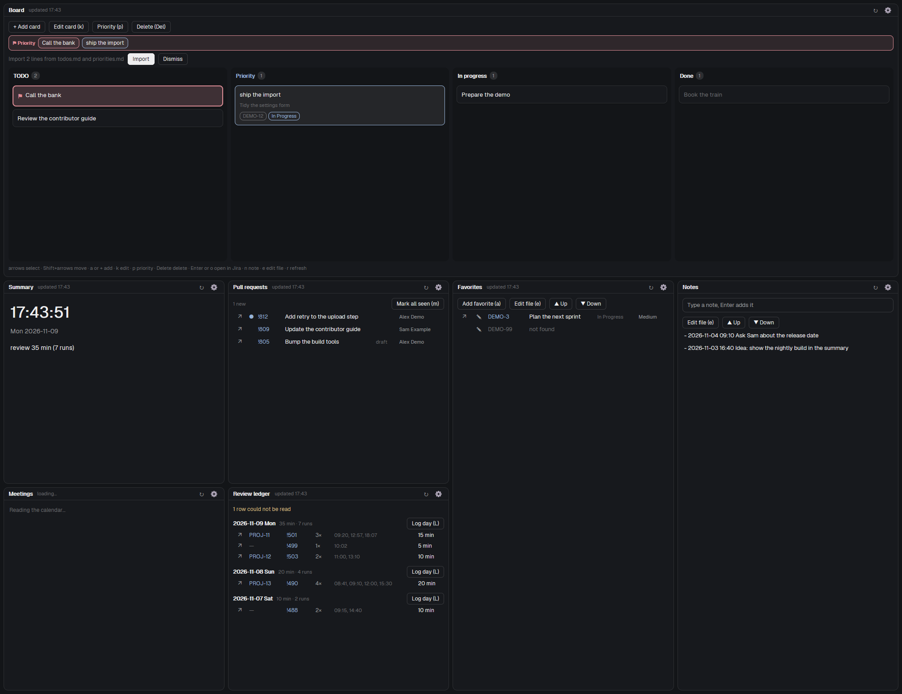

# Friday

A work dashboard for herdr-app, built as one mod. A Friday tab holds several panes of the mod, and each pane shows one widget: a summary with a clock, today's meetings, Jira favorites, Azure DevOps pull requests, a review ledger, priorities, todos, notes, and a kanban board. herdr-app moves, resizes and splits the panes; the mod only draws them. Nothing runs when herdr-app is closed.

## What you see

The mod is one `main.js` that draws whichever widget `props().widget` names. Every pane has a one-row header with the widget's title, a refresh button (↻), a gear that opens Settings, and a `+` that opens the add menu. All colors come from `theme()`; the mod has no theme or font of its own.

- **Summary:** the clock (updates every second), the next meeting, counts from Jira, Azure DevOps and the review ledger.
- **Meetings:** today's meetings from a secret iCal address, with the time, title and a join button (▶) for Teams and Google Meet links. Past meetings are hidden; `h` shows them.
- **Favorites:** a list of Jira issues kept in a `.md` file, with their status. ↗ opens the issue, ✎ logs time.
- **Pull requests:** active Azure DevOps pull requests for one project and one or more repositories, with the repository named on each row. ↗ opens the PR.
- **Review ledger:** days and per-PR rows read from a Markdown file the owner keeps. Read only. A day can be logged to Jira as worklogs.
- **Priorities, Todos, Notes:** plain `.md` files. Todos toggle with Enter. Notes have an always-visible input; Enter adds a timestamped line.
- **Board:** a `board.md` as columns of cards (TODO, In progress, Done). Cards drag with the mouse or move with Shift+arrows; `p` flags a priority card, `k` edits its text, `a` or `+` adds one, Delete asks first.

Rows that have an action start with an icon. A click selects a row; Enter or a double-click does its main action. A failing source shows its message in the pane, never a blank pane.

Three ways to show the widgets:

1. **The Friday tab.** `herdr-app do mod.open --name friday`, or the key bound to `mod.open:friday`, selects the tab or creates it. A new tab starts from the default arrangement: summary, then todos below it, meetings to the right, pull requests below that. After that the owner rearranges the panes with herdr-app, and the arrangement is remembered (see below).
2. **`layouts/friday.json`, `layouts/friday-board.json`:** whole-window layouts with a column or a row of Friday blocks next to herdr-app's own sidebar, tab bar and terminals.
3. **`layouts/friday-panel.json`:** herdr-app's main layout with a `Friday ▾` button before the tabs. Checked widgets open in a panel on the right.

## How it behaves

- **Polling.** There is no background process. A hub polls while herdr-app is open: the ledger every 15 s, Jira every 300 s, Azure DevOps every 120 s, the calendar every 600 s. One fetch per source runs across all panes, shared through a lease kept in `shared()`.
- **Alerts.** The pane holding the calendar lease toasts a meeting at its offsets. Each alert fires at most once per occurrence and offset (recorded in `alerts.json` before the toast). An alert found more than 60 s late is dropped, so a laptop that slept does not replay old alerts. All-day events get none.
- **New pull requests.** The first fetch of a repository is a baseline with no toasts. After that a new PR toasts once, recorded in `prs.json` first.
- **Writes.** The mod only writes its own data folder, plus these Jira calls: worklogs (and their comments), each confirmed in a dialog first. It never writes to Azure DevOps, the calendar or the ledger.
- **Lists.** `todos.md`, `notes.md`, `priorities.md` and `board.md` belong to the owner. A move changes no line's text. The mod never rewrites a line it did not change, keeps CRLF, BOM and a missing final newline, and deletes only a board card, a priorities row or a favorite the owner confirmed. Edits made by hand are picked up through `watchFolder` (with a 3 s timer as a fallback).
- **Remembered tab (Windows only).** The panes check about every 10 s how the tab is arranged and save its widgets, splits and sizes to `arrangement.json`. Closing the tab keeps the file; the launcher rebuilds from it. A bad or missing file gives the default arrangement. Elsewhere nothing is saved. The arrangement is read from herdr-core's own `docs.json`, which is only ever read.
- **Settings** (the gear): Calendar, Jira, Azure DevOps, Review ledger. Each has a Test button. Saving never shows a secret again.

## Built from

- **Mod:** `mods/friday/main.js` is one class that extends `View` (`gpui-kit`) and renders the widget named by `props().widget`; the same class also draws the dialogs (`props().dialog`), the pane header (`props().paneHead`), the launcher (`props().overlay`) and the panel button (`props().panelMenu`). `mod.json` is `{ "place": "none", "focusable": true, "overlay": { "width": 2, "height": 2 } }`.
- **Layout:** `core/` holds the pure logic and never imports `herdr`; `widgets/` and `dialogs/` stay thin over it; `hub.js` polls; `store.js` reads and writes the data folder.
- **herdr module:** `props`, `theme`, `panes`, `spaces`, `focused`, `run`, `layout`, `openOverlay`, `closeOverlay`, `nextCommand`, `shared`, `setShared`, `watchFolder`, `window`, `exec`, `appHome`, `readTextFile`, `writeTextFile`. Commands used with `run` include `tab.new`, `tab.select` and `pane.split`.
- **Data folder:** `${appHome()}/data/friday/`:
  - `settings.json`
  - `secrets.json`
  - `alerts.json`
  - `prs.json`
  - `arrangement.json`
  - `todos.md`
  - `notes.md`
  - `priorities.md`
  - `board.md`
  - `favorites.md`
  - ledger file (the path is a setting)
- **Network.** Friday calls only the services the owner configures:
  - the iCal address (a secret URL, `ical_url`);
  - the Jira Cloud site, with an email and an API token (`read:jira-work`, `write:jira-work`, scoped or classic);
  - Azure DevOps (`dev.azure.com/<org>`), with a PAT scoped to Code (Read).
- **Programs.** `exec` runs only the OS's opener (`rundll32 url.dll,FileProtocolHandler` on Windows, `open` on macOS, `xdg-open` on Linux) with a single argument that is an `https` link or an absolute path. No shell.
- **Vendored:** `vendor/ical.js` (ical.js, MPL-2.0), loaded with a dynamic `import()`.
- **Keys:** `friday.settings` and `friday.add` can be bound in the owner's `keys.json`. Nothing is bound by default.

## Watch out

- **Declare the reach to the owner before installing.** The mod uses the network (iCal, Jira, Azure DevOps), runs the OS opener through `exec`, and reads and writes files in its own data folder and the owner's ledger file. It reads, but never writes, herdr-core's `docs.json`.
- **Secrets.** The iCal address and both tokens live only in `secrets.json`: never in `shared()`, `localStorage`, logs, errors, toasts or screenshots.
- **The runtime is QuickJS.** There is no `setTimeout`/`setInterval` (use `cx.timer`), no `AbortController` (race `fetch` against a timer), no `Intl`, and `btoa` instead of `Buffer`. A `fetch` response has no `headers`, so `Retry-After` cannot be read and the backoff always doubles by itself. Never keep a `cx`. Every copy of the mod has its own module scope, so state shared between panes goes through `shared()`.
- **A job that runs about 0.5 s without `await cx.sleep(0)` is silently ended**: no `catch`, no `finally`, no error in `herdr-app status`. Calendar expansion, the ledger parser and the markdown parsers yield for this reason, and the recurrence expansion has step budgets.
- **Calendar.** Recurrence, EXDATE, RECURRENCE-ID and DST each have test fixtures. Date has one offset for all dates in QuickJS, so the machine's offset is passed in.
- **Windows first.** The remembered tab reads `docs.json` by its Windows path and does nothing elsewhere. macOS and Linux open links and files, but the default arrangement always returns. Windows junctions do not trigger herdr-app's reload on change: close the Friday tab and open it again.
- **Layouts.** A copy of the mod in a layout block is not a pane: its props carry `"block": true`, which turns off the first-pane arrangement and the `+` menu. Keep the Friday tab open too: it keeps the alerts running across layout switches.
- **Checked against herdr-app 0.1.14.** `herdr-app check mods/friday` must pass; `node --test` covers `core/`. Layout and drag behavior cannot be tested without a window, so look at a change in the live app.
- **Screenshots.** `preview.png` shows made-up data seeded by `scripts/demo-home.mjs` in a sandbox app home (`HERDR_APP_HOME`), never a real one.
